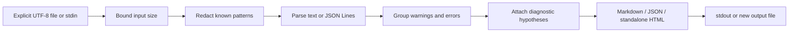

# Log Sieve

**离线整理日志：合并重复报错、脱敏常见凭据、生成可审阅的排查摘要。**

**Offline log triage:** group repeated warnings/errors, redact common credential
patterns, and export a short report with practical troubleshooting hypotheses.
Zero runtime npm dependencies. No network, telemetry, subprocesses, or AI service.

## 快速开始 / Quickstart

Node.js **22+** and npm are required. From this source directory:

```sh
npm ci --ignore-scripts
npm run build
node dist/cli.js analyze examples/application.log
node dist/cli.js analyze examples/application.log --format json
node dist/cli.js analyze examples/application.log --format html --output review.html
npm test
```

`--output` creates a **new** file. Choose another name on a repeated run.
To install the built command from source:

```sh
npm install --global . --ignore-scripts
logsieve --help
logsieve analyze /path/to/application.log
```

The npm package name is `log-sieve-cli`; the executable is `logsieve`.
This installation uses the local checkout and does not require an npm publication.
Quote paths with spaces on Windows, for example `"C:\My App\application.log"`.

## 用法 / Usage

```sh
logsieve analyze app.log --format markdown
logsieve analyze app.jsonl --format json --fail-on error
logsieve analyze app.log --format html --output incident-review.html

# Read stdin; for example on POSIX shells:
cat app.log | logsieve analyze - --format json
```

Options use separate arguments, such as `--format json`. Default output is
Markdown on stdout. `--fail-on error` includes fatal errors; `--fail-on warning`
also includes warnings. The report is emitted even when a threshold is crossed.

| Exit | Meaning |
| --- | --- |
| `0` | Report generated; requested threshold not crossed |
| `1` | Invalid input, unsupported encoding, size limit or I/O failure |
| `2` | Report generated; requested warning/error threshold crossed |

## 示例 / Example

Input:

```text
2026-10-22T02:00:00Z INFO starting service
2026-10-22T02:00:01Z ERROR ECONNREFUSED 127.0.0.1:5432 token=synthetic-demo-a
    at connect (database.js:18:4)
2026-10-22T02:00:02Z ERROR ECONNREFUSED 127.0.0.1:5432 token=synthetic-demo-b
```

The report contains **one error group with two occurrences**, a stack sample and
checks for the expected service, address and port. The two synthetic token values
are replaced before grouping and do not appear in the report. See the committed
[standalone HTML example](examples/report.html) and [Markdown example](examples/report.md).

## 输入与诊断 / Input and diagnostics

- Text levels: TRACE, DEBUG, INFO, WARN/WARNING, ERROR, FATAL/CRITICAL; optional
  ISO-like timestamp prefixes and common multiline stack traces.
- JSON Lines: `message`/`msg`, `level`/`severity`, `timestamp`/`time`/`ts`, and
  `error`/`err` message/stack fields. Numeric Pino levels 10–60 are supported.
- Malformed JSON falls back to text and is counted. Entries without a recognized
  level count as `unknown`; they are not assumed to be errors.
- Fingerprints normalize UUIDs and hexadecimal addresses, retaining error codes
  and port numbers. Groups sort by severity, frequency and first source line.
- Eight rule categories cover refused connections, DNS, timeouts, permissions,
  missing resources, memory limits, port conflicts and TLS validation.

Suggestions are **hypotheses**, not confirmed root causes or commands to execute.
The CLI never changes the source log or runs a proposed fix.

## 隐私与限制 / Privacy and limits

Redaction covers common key/password/token assignments, bearer credentials,
credential query parameters (including percent-encoded names), URL userinfo,
GitHub/AWS access-key patterns, and private-key blocks. Structured JSON fields and
string messages are inspected before grouping. Match counts are pattern matches,
not a count of proven secrets.

Terminal styling and direction controls are normalized before matching, including
escaped controls in decoded JSON values and credential field names. Input size
and line limits are checked before this normalization.

**Redaction is incomplete.** Unrecognized secrets, personal data, hosts and paths
may remain. Logs and generated reports require human review before sharing.
This is not a general-purpose anonymizer or a security guarantee.

Only explicit regular-file or stdin input is read. Input must be UTF-8, at most
16 MiB, 100000 lines and 64 KiB per line. JSON logs are one object per line;
pretty-printed JSON, compressed archives, recursive discovery and live tailing
are outside this version. Stack samples retain at most 30 lines per group.

HTML is a standalone document with escaped text, no JavaScript or external
assets, and a Content Security Policy blocking active content. JSON has
`schemaVersion: 1`. Identical input produces identical output; no wall-clock
generation timestamp or input filename is included.

## 架构 / Architecture



`redact.ts` handles pattern redaction; `analyze.ts` parses, groups and attaches
rules; `render.ts` escapes/formats output; `cli.ts` owns bounded input, option
validation and exclusive output. `index.ts` exports the library API.

## 开发与贡献 / Development and contributing

```sh
npm ci --ignore-scripts
npm test
npm run build
npm run check:package
```

Tests use synthetic logs and credentials, including a real CLI smoke test. The
package gate installs the tarball offline and runs the installed executable.
CI covers Linux, Windows and macOS. Development dependency installation and
GitHub publication require network access; log analysis does not.

See [CONTRIBUTING.md](CONTRIBUTING.md), [AGENTS.md](AGENTS.md),
[SECURITY.md](SECURITY.md), and the [90-day plan](docs/maintenance-plan.md).
中文和英文的问题反馈均可。

## License

[MIT](LICENSE), Copyright (c) 2026 Log Sieve contributors.
